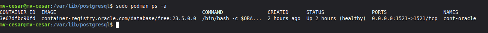
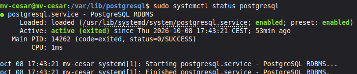
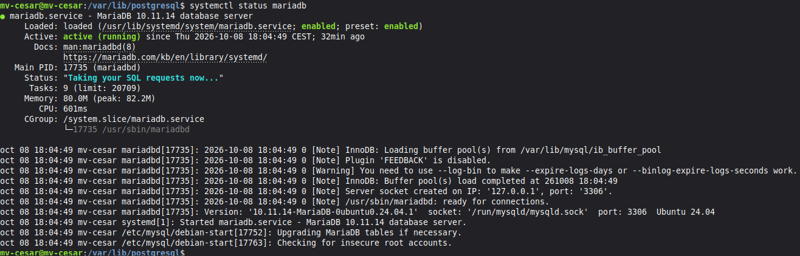

# Blanco-Salguero-Tarea22-Instalar-tres-SGBD

## Características de la VM
La VM está configurada con las siguientes características:

* 4GB de RAM.
* 2 CPUs.
* 250GB de almacenamiento.
* SO: Linux Mint 22.3

## Versiones instaladas
Estas son las versiones de los tres SGBD que he desplegado:

* Oracle Database 23ai Free: `23.5.0.0` (imagen de contenedor).
* PostgreSQL: `16.15` (`psql --version`).
* MariaDB: `10.11.14` (`mariadb --version`).

## Oracle Database 23ai Free con Podman
Primero debemos descargar Podman (un software similar a Docker en el que puedes usar contenedores), para ello actualizaremos los repositorios, instalaremos, descargaremos la imagen del contenedor y, para comprobar que todo esté bien, los listaremos. Los comandos que debemos usar son los siguientes:
```bash
sudo apt update
sudo apt install podman
sudo podman pull container-registry.oracle.com/database/free:23.5.0.0
sudo podman images
```

### Creación y comprobación del contenedor
Para asegurarnos de que la BD y su configuración no se pierda al reiniciar o borrar el contenedor, creamos un volumen con nombre `oracle_23ai_datos`. Luego iniciamos el contenedor, mapeando el puerto `1521` y montando el volumen:
```bash
sudo podman volume create oracle_23ai_datos
sudo podman run -d --name cont-oracle -p 1521:1521 --restart=always -v oracle_23ai_datos:/opt/oracle/oradata:U container-registry.oracle.com/database/free:23.5.0.0
```
Después de que se cree el contenedor debemos comprobar que se esté ejecutando y esperar a que su estado pase a `healthy`:
```bash
sudo podman ps -a
sudo podman logs cont-oracle
```

### Entrar en Oracle y crear el usuario de trabajo
Entramos con privilegios de administrador (`sysdba`) para crear el usuario de trabajo con el comando:
```bash
sudo podman exec -it cont-oracle sqlplus / as sysdba
```
Listamos las BDs conectables y pasamos a la PDB `FREEPDB1`, donde creamos el usuario `orauser` dándole los permisos y el almacenamiento necesarios:
```sql
SHOW PDBS
ALTER SESSION SET CONTAINER = FREEPDB1;
CREATE USER orauser IDENTIFIED BY "TU_CLAVE";
GRANT CREATE SESSION, CREATE TABLE TO orauser;
ALTER USER orauser QUOTA 100M ON USERS;
EXIT
```
Y comprobamos la conexión con el comando:
```bash
sudo podman exec -it cont-oracle sqlplus orauser@//localhost:1521/FREEPDB1
```

## Desplegar PostgreSQL
Actualizamos repositorios, instalamos PostgreSQL, iniciamos sus servicios y los activamos, y entramos con los siguientes comandos:
```bash
sudo apt update
sudo apt install postgresql postgresql-contrib php-pgsql
sudo systemctl start postgresql
sudo systemctl enable postgresql
sudo -i -u postgres
psql
```
Al entrar en postgres, usamos los siguientes comandos para crear la base de datos `dbpg`, el usuario `pguser` con su contraseña, darle todos los privilegios y salir de la consola psql:
```sql
CREATE DATABASE dbpg;
CREATE USER pguser WITH PASSWORD 'TU_CLAVE';
GRANT ALL PRIVILEGES ON DATABASE dbpg TO pguser;
\q
```
Salimos de la sesión del usuario postgres y comprobamos la conexión:
```bash
exit
psql -h localhost -U pguser -d dbpg -W
```

## Desplegar MariaDB
Actualizamos los repositorios del sistema, instalamos el servidor y cliente de MariaDB, habilitamos e iniciamos el servicio con `systemctl`, y accedemos a la consola como administradores:
```bash
sudo apt update
sudo apt install mariadb-server mariadb-client
sudo systemctl enable --now mariadb
sudo mariadb
```
Dentro de MariaDB, creamos la base de datos `dbm` con los caracteres `utf8mb4`, y creamos el usuario `muser`, dándole todos los privilegios de la BD:
```sql
CREATE DATABASE dbm CHARACTER SET utf8mb4 COLLATE utf8mb4_unicode_ci;
CREATE USER 'muser'@'localhost' IDENTIFIED BY 'TU_CLAVE';
GRANT ALL PRIVILEGES ON dbm.* TO 'muser'@'localhost';
FLUSH PRIVILEGES;
EXIT;
```
Y comprobamos la conexión con el comando:
```bash
mariadb -u muser -p dbm
```

## Comprobaciones
**Estado de Oracle** (el contenedor `cont-oracle` aparece en estado `healthy` en `sudo podman ps -a`):


**Estado de PostgreSQL** (el servicio está activo y habilitado con `systemctl status postgresql`):


**Estado de MariaDB** (el servicio está activo y habilitado con `systemctl status mariadb`):


### Comprobación de conexiones con los usuarios de trabajo
Verificamos el acceso local de cada usuario a su base de datos correspondiente:

* **Oracle (`orauser` en `FREEPDB1`):**
```bash
sudo podman exec -it cont-oracle sqlplus orauser@//localhost:1521/FREEPDB1
```
* **PostgreSQL (`pguser` en `dbpg`):**
```bash
psql -h localhost -U pguser -d dbpg -W
```
* **MariaDB (`muser` en `dbm`):**
```bash
mariadb -u muser -p dbm
```

## Resumen
| SGBD | IP | Base/servicio | Puerto | Usuario | Contraseña |
| --- | --- | --- | --- | --- | --- |
| Oracle 23ai Free | localhost | FREEPDB1 | 1521 | orauser | ----- |
| PostgreSQL | localhost | dbpg | 5432 | pguser | ----- |
| MariaDB | localhost | dbm | 3306 | muser | ----- |

## Configuración de red
No he habilitado conexiones desde otra máquina: los tres gestores escuchan solo en localhost y no ha sido necesario abrir puertos en el firewall. Si en el futuro hace falta acceso remoto, hay que cambiar `listen_addresses` y `pg_hba.conf` en PostgreSQL, `bind-address` en MariaDB, y permitir el puerto correspondiente con `ufw` solo para la IP o subred autorizada.

## Problemas encontrados y soluciones
**1. Error al crear el contenedor de Oracle.**
Al copiar el comando `podman run` venía partido en dos líneas, así que bash lo interpretó como dos comandos: uno con la imagen mal escrita y otro que no existía. El error fue:
```
Error: short-name "container" did not resolve to an alias...
bash: registry.oracle.com/database/free:23.5.0.0: No existe el archivo o el directorio
```
Lo solucioné escribiendo el comando completo en una sola línea y el contenedor se creó correctamente.


## Fuentes consultadas
* Guion de la práctica "Práctica: instalar tres SGBD".
* Documentación oficial de Oracle Database Free: https://www.oracle.com/es/database/free/get-started/
* Documentación oficial de PostgreSQL: https://www.postgresql.org/docs/
* Documentación oficial de MariaDB: https://mariadb.com/kb/en/documentation/